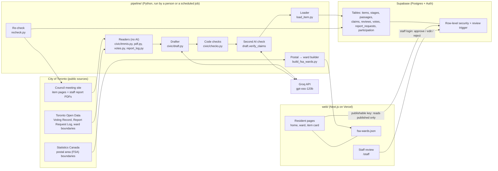
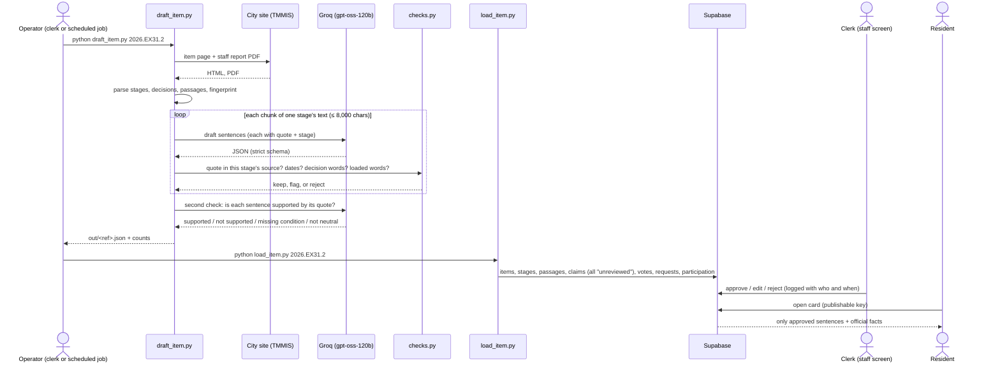
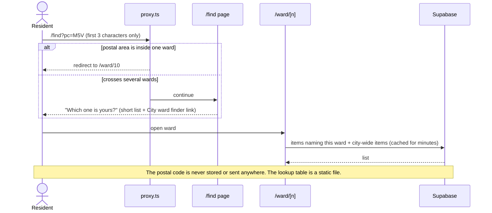
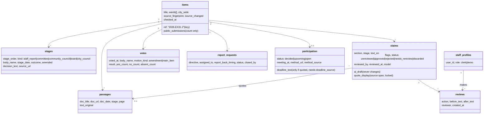
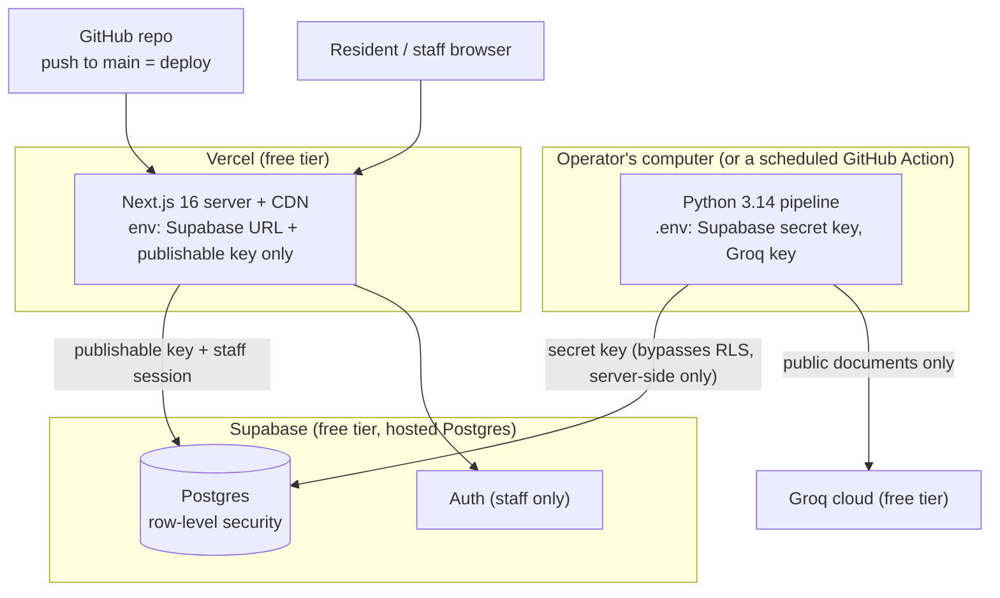

# Architecture

Plain Council has three parts:

1. A **Python pipeline** that reads official records and drafts summaries, run once per item.
2. A **Supabase database** that stores everything and enforces who can see and change what.
3. A **Next.js website** for residents and staff.

The diagrams below are written in Mermaid, so they render on GitHub.

## 1. Components (UML component diagram)

**Rule of thumb:** facts come from code and AI writes words.
- Code reads every date, stage, outcome, vote, ward, submission count and participation status from the official records.
- AI only drafts plain-language sentences, and each one must carry a quote that code finds in the source.

## 2. How a card is made (UML sequence diagram)

## 3. Resident lookup (UML sequence diagram)

## 4. Data model (UML class diagram)

`changes`, `requests` and `job_runs` also exist in the schema. They're reserved for features this prototype runs by hand: stored redline sentences, the "Add item" queue, and the scheduled-job log.

## 5. Deployment (UML deployment diagram)

## 6. Why it's built this way

| Decision | Why | Alternatives considered |
|---|---|---|
| **AI runs offline, once per item**, and a person approves every sentence | The brief says a wrong summary is worse than none. Pre-processing makes every published sentence reviewable, keeps cost flat no matter how many residents visit, and means no resident data ever reaches an AI service | A live chatbot that answers questions on demand. Rejected: its answers can't be reviewed before residents see them, and it costs money per question |
| **Facts from code, words from AI** | Dates, votes, stages and deadlines are where errors do the most harm, and they are already structured in the records | Letting the AI extract everything. Rejected after run 1 copied legal wording and could not be trusted on dates |
| **Quote check against the same step's source** | A sentence can't claim to be "from the committee" while quoting the staff report. Rejecting unsourced sentences is cheap and reliable | Trusting AI citations. Rejected: models invent or blend quotes |
| **Supabase (Postgres + row-level security)** | The rule "the public sees only approved sentences" is enforced by the database, not just by website code. Auth and an audit trigger come built in | JSON files in the repo: simpler, but there's no staff login and no enforced review |
| **Database trigger on review** | Records who reviewed and when. Stops anyone (even a logged-in clerk) from changing a sentence's source quote or the original AI draft. Makes permanent rejection final | Recording this in website code only. Rejected: a direct database call would bypass it |
| **Next.js with cached pages on Vercel** | Cards are mostly static. Caching makes them fast and cheap; a clerk's action refreshes that card at once | A single-page app calling the database from the browser. Slower on phones and more exposed |
| **Postal area (first 3 characters) → ward, precomputed** | Residents usually know their postal code but not their ward. The first 3 characters identify an area, not a household. A static file means nothing is sent or stored | Full address geocoding: more precise, but sends a resident's address to a third party |
| **Word-level redline in code, no AI** | Amendments are where meaning changes, so the official wording is shown exactly | An AI summary of each change. Possible later, but it would also need review |
| **Groq + open-weight model behind one setting** (`GROQ_MODEL`) | Free tier, fast, and swappable. A city could point it at a provider or model its procurement allows | A closed model: also fine, but it ties the city to one vendor |

## 7. Scaling and adapting

- **More items.** The pipeline cost is about 5–10 Groq calls per item, once. The website's cost doesn't grow with the number of items. For all of Toronto's agenda items (a few thousand a year), Groq's paid tier would cost a few dollars a month. Supabase's free tier holds this prototype's data many times over.
- **Review effort is the real cost.** Each item takes a clerk about 10–20 minutes. In this prototype, code and the checker flagged 11 of 63 drafted sentences. The rest still need a person, because the review found problems the checks missed (see [ai-and-verification.md](ai-and-verification.md)).
- **Other municipalities.**
  - Only `civic/tmmis.py` (the item page reader) and `report_log.py` are Toronto-specific.
  - A city on eSCRIBE or Granicus would write one reader that returns the same `ItemRecord` (title, wards, stages with decision text, documents).
  - The ward lookup is rebuilt with `build_fsa_wards.py` from that city's ward boundaries.
- **Scheduled jobs.**
  - `recheck.py` and the draft/load scripts are plain command-line tools, so a nightly GitHub Action or Supabase cron can run them.
  - Anything ingested automatically stays "unreviewed" until a person approves it.
